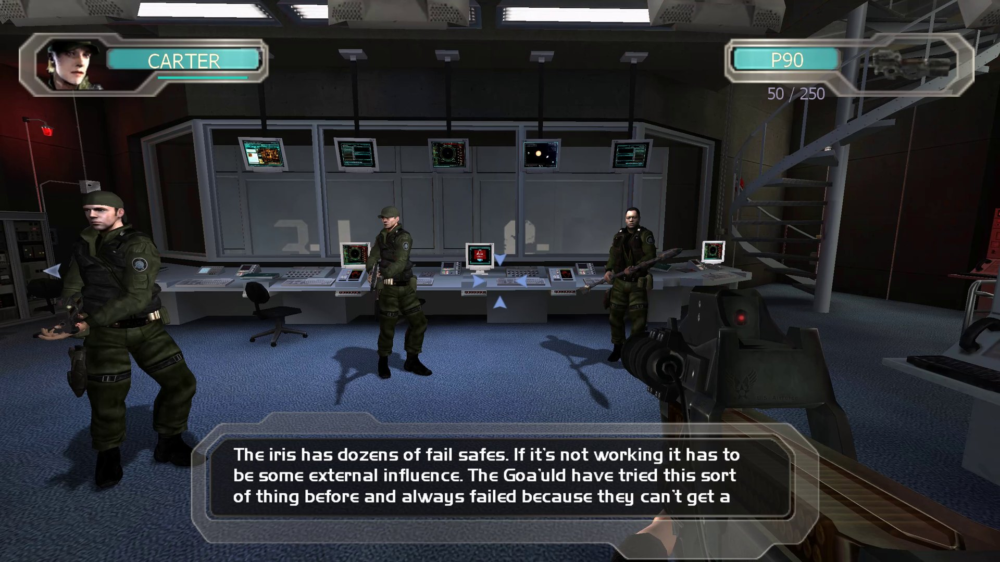
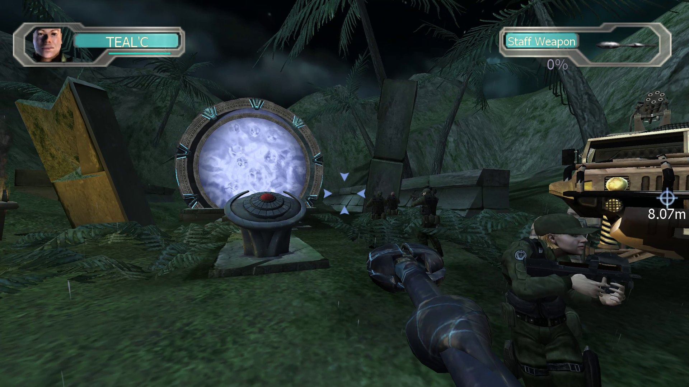
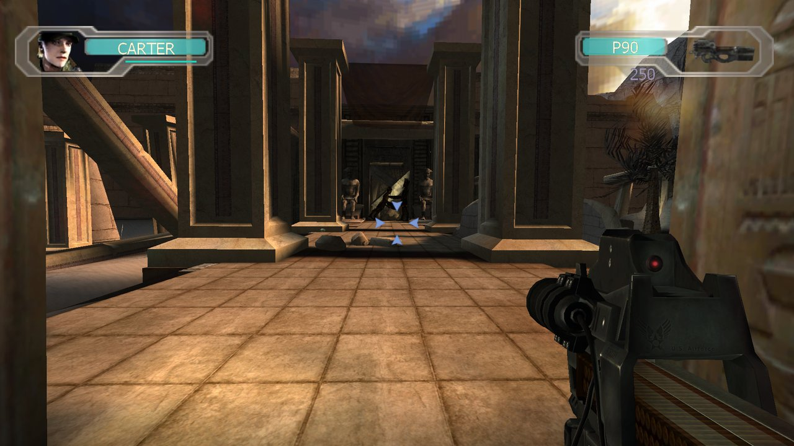
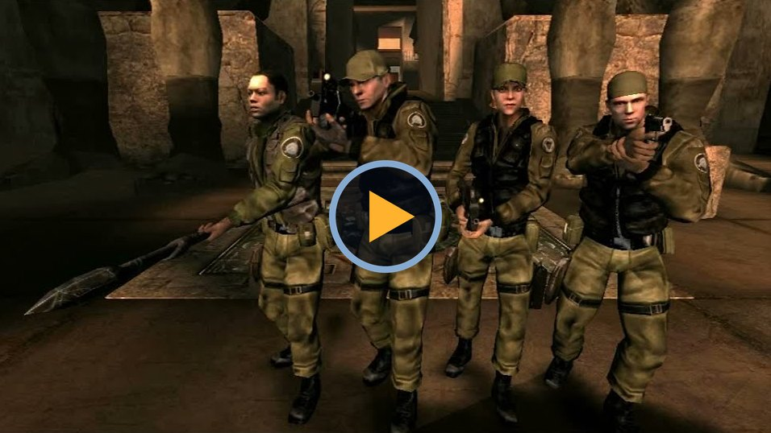

<!-- Public repository https://github.com/Stargate-Redial/alliance-redial: this README, CHANGELOG.md, NOTICE.md, docs/GUIDE.md, docs/KNOWN_ISSUES.md, docs/CHEATS.md and docs/SERVER.md only; the installer is a Release asset. Also shipped inside the release zip. -->
# Stargate SG-1 The Alliance: Redial

  
  
  

*A [Stargate Database](https://stargatedatabase.link/en/) project* · *Un projet [Stargate Database](https://stargatedatabase.link/fr/)*

:gb: **English** · :fr: [Français](#français)

The unreleased *Stargate SG-1: The Alliance* (an Xbox prototype from December 2005), as a native PC port. It runs
on the **Unreal Tournament 2004** engine with the OldUnreal patch, so you need UT2004 to play. A [Stargate Redial](https://github.com/Stargate-Redial)
fan project by the [Stargate Database](https://stargatedatabase.link/en/) team. Current release: **V0.1**. Join the community on [Discord](https://discord.gg/SgHPP4mZyB).

> Apart from its title picture, no game data is included: the installer rebuilds the game on your PC from your
> own copy of the 2019 release. Fan project, not affiliated with or endorsed by MGM, Perception, JoWooD,
> Microsoft or Epic Games. See [NOTICE.md](NOTICE.md).

## 🚀 Quick start

1. **UT2004 with the OldUnreal patch.**
   - **No UT2004 yet?** Install it with OldUnreal's
     [full-game installer](https://www.oldunreal.com/downloads/ut2004/full-game-installers/): it also installs
     the latest OldUnreal patch, nothing else to do.
   - **Already have it** (Steam, GOG, CD)? Add the latest
     [OldUnreal patch](https://github.com/OldUnreal/UT2004Patches/releases) (3374, 2026-10-20 or later).
   - Our installer checks the patch version and tells you if it is too old.
2. **The 2005 game files.** Download [`Stargate_SG-1_-_The_Alliance-2005-12-15.7z`](https://archive.org/download/StargateSG1TheAlliance20051215/Stargate_SG-1_-_The_Alliance-2005-12-15.7z)
   (about 1 GB, direct download from archive.org; the [archive.org page](https://archive.org/details/StargateSG1TheAlliance20051215) has the details)
   and leave it in your Downloads folder.
3. **The installer.** Download `Stargate-Redial-Alliance-v<version>-win64.zip` from the
   [Releases page](https://github.com/Stargate-Redial/alliance-redial/releases), extract it and run
   **Stargate Redial Setup.exe** (if SmartScreen appears: *More info*, then *Run anyway*).
4. **Install, then play.** The window finds the `.7z` and UT2004 by itself: click *Install* (a few minutes), then
   *Play*. Next time, start the game from its Start menu or desktop shortcut: it checks for updates automatically and installs them in one
   click.

## 🎬 The 2005 trailer

  

  The E3 2005 trailer by JoWooD and Perception, on YouTube. See also the <a href="https://www.youtube.com/watch?v=ZrCbDSjDTZ0">first teaser</a> (March 2005). 
  Some scenes may differ from the December 2005 build.

### 🎙️ The story behind the game

In August 2025, *Dial the Gate* (episode 349) welcomed **Ben Lenzo**, CEO of Perception at the time, to talk about
The Alliance: the deal with MGM, the story he wrote, the new Haaken enemy, each team member's abilities, the planned
four-player co-op, and what happened to the game, with nearly half an hour of game footage.
▶ **[Watch the interview on YouTube](https://www.youtube.com/watch?v=raCHv9FzVNU)** (about 2 h 8 min, in English).

## 🛸 About this prototype

This is an **unfinished game**: a December 2005 Xbox prototype that was never completed or released. We restore
and fix what exists and add nothing new.

- **The real SG-1:** voiced by the show's cast, Richard Dean Anderson (O'Neill), Amanda Tapping (Carter),
  Michael Shanks (Daniel Jackson) and Christopher Judge (Teal'c), with Carmen Argenziano as Jacob Carter, in
  sessions directed by the series' Peter DeLuise. The SGC is there too: even Walter is a playable character in
  multiplayer.
- **Stargate action:** give orders to your squad, drive vehicles, and dial the Stargates on the multiplayer maps.
- **Playable:** the solo campaign, from your training at Cheyenne Mountain to the final battle:
  - a jungle at night, on the trail of the first piece of the artifact;
  - the rescue of SG-2 on P8J-331;
  - an ancient city and its catacombs, following the Reetou's lead;
  - Langara under attack by Anubis, from the wetlands to the mines;
  - Anubis' shipyard in the Lamoora system;
  - the Tok'ra base on P7C-103, before Anubis strikes;
  - the search for Grey, in the crystal forest where Oma Desala appears;
  - the moon base on P4J-549;
  - the evacuation of the Beta Site;
  - Stargate Command overrun by Anubis' Jaffa and Super Soldiers;
  - the assault on Tartarus, Anubis' fortress;
  - and the Haaken mothership.

  And multiplayer: DeathMatch, Team DeathMatch, Capture the Flag and Last Man Standing, on ten maps.
- **Expect flaws:** some surfaces are plain white or grey where the 2005 data has no texture; a few sounds and HUD
  icons are missing; mouths move only in some dialogues; some features were never built
  (co-op, split-screen, the *Extras* page) and are hidden; Capture the Flag with bots is rough.
- **The story may not make full sense:** seven missions are not in the build (the first one, *Replicator Attack*
  aboard Thor's ship, was cut), so the story jumps between missions, and some recorded scenes are never played.

See [KNOWN_ISSUES.md](docs/KNOWN_ISSUES.md) and the [CHANGELOG](CHANGELOG.md).

## ✨ What Redial brings

A few highlights (the [CHANGELOG](CHANGELOG.md) has the full list):

**🧩 Restored from the 2005 data**
- Last Man Standing is back in the multiplayer mode list.
- About 150 recorded voice lines that the 2005 game never played are back in the squad's chatter.
- The SG-1 crew's lip sync plays in every mission, where the 2005 build had it in only a few.
- Cheat codes work from the console in single player ([docs/CHEATS.md](docs/CHEATS.md)).
- Menu and HUD features that were left unwired are back, such as Options from the pause menu and the binocular read-out.
- Each chapter's mission briefing (location, local time, objective) is shown in Chapter Selection.
- Loading screens use the game's own loading art, as Perception's PC version did, instead of the Xbox controller
  picture.
- Characters move as in 2005 again: each weapon's own torso pose, idle gestures, crouching on bent legs, jumps and
  landings, also for other players online. Characters no longer slide upright before they start walking.
- Characters standing still no longer make footstep noises that kept enemies suspicious: in M13C the Jaffa blow
  the crystal wall open after Carter's "Incoming", as in 2005.
- The squad's Hold Position (H) and Follow Me (G) orders, finished in 2005 but never given a key, have keys now.

**🖥️ Made for PC**
- Mouse and keyboard, or an Xbox controller with the original 2005 layout.
- Any resolution up to 4K, widescreen field of view, and quick save (F5) and quick load (F9).
- Menus that work with a mouse click, with real buttons on every page, and graphics at their highest by default.
- Better graphics than 2005: sharper character and vehicle shadows, smoother skies, a fixed and cleaner bloom, the
  electric arcs of the Zat'nik'tel and the Kull disruptor back on screen, and scenery that no longer blinks in and out.
  Direct3D 9 is the default; Direct3D 11 is offered as an experimental option with anti-aliasing.
- Real-time shadows the 2005 build never had: trees, rocks, statues, walls and other outdoor scenery now cast their
  shape on the ground, and every character has a shadow. The emissive glow the Xbox switched off is back on the
  lights and consoles, windows shatter again, and an optional depth of field blurs the scenery around your scope's
  target.
- A sharper loading picture in full screen: the installer makes a 4x larger copy of the 2005 picture on your PC.
- The weapon panel shows the clip and the reserve (e.g. 30 / 250), and characters no longer sink into some floors.
- Fixes for 2005 placeholders: no stray arms around the C4 in first person, a grey ribbon device icon instead of the
  violet one, real models for the ribbon device, frag grenade and C4 instead of a P90, every campaign P90 now has
  the torch (L), and no more "PLACE-HOLDER" banner over the unfinished cutscenes.
- Menus made easier: readable drop-down lists, a restart prompt for settings that need one, and a chapter list where
  one click shows the briefing and Start launches the mission.
- Pausing also pauses dialogue and music, and the campaign's one-weapon-per-slot rule works again.
- Its own name and icon in the Windows taskbar, with desktop and Start menu shortcuts.

**🌐 Online**
- **Official servers online 24/7** (Deathmatch, Team Deathmatch, Last Man Standing), with bots so there is always
  a game going: *Multi-Player → Internet → Find Match*.
- Internet and LAN games, and dedicated servers for Windows and Linux.
- Bots in every multiplayer mode, and fair ones: they fire at a player's rate, and Zat, shock grenade and ribbon
  device hits count on them too.
- A weapon pack per side, and a *Change Character* option in game.
- The Zat'nik'tel and the shock grenade need two hits to kill in multiplayer: the first one slows you to half speed
  for 5 seconds, but you can still fire, and a second hit within that time kills (in 2005 one hit killed a player).
  The shock grenade no longer hits your own team or through walls. Knock-backs no longer make you jump on your own
  screen online, and the cloak works online for every player, not only for the host.
- A quick voice menu (V) with each character's own 2005 voice, and text chat that servers can relay to Discord.
- You respawn with your pack's main weapon in hand and every pack weapon listed at once. Other players' bullet
  tracers reach your screen, the shock grenade's flash no longer floods rooms through walls, every character holds
  its weapon (the Tok'ra included), and Team Deathmatch names show their team colour.
- The Assault pack's P90 now shows in your hands online, with its tracers.
- Online you now see other players flinch when hit and fly back, land and get up after a knock-back, as the 2005
  game showed only on the server.
- Last Man Standing: bots come looking for you (but never all at once), a player joining a bots-only round restarts
  it, and a round ends as soon as one player is left. Bots wait for Langara's trains, and the missile launcher riding
  the train now rides it for everyone.
- Smarter bots in every mode: they no longer jump off the Kelownan train into the void, no longer blow themselves
  up with a grenade thrown at a nearby wall or a charged staff blast at point-blank range, charge an enemy out of
  reach instead of sniping across Ha'tak's decks, no longer chase each other through the rings, and no longer dodge
  a grenade onto Langara's tracks in front of a train.

**⚙️ Easy to live with**
- One-click automatic updates, with your settings and saves kept.
- Your solo progress at a glance: a percentage in the Single Player menu, a tick on every chapter you finished,
  and Chapter Selection opens on the one you are at.
- *Continue* in the Single Player menu too, and no profile to manage: the game makes one for you.

---

## 🔄 Automatic updates

- Starting the game from its shortcut checks this GitHub page for a new version: no account, no personal data.
- A window shows what is new and updates in one click; the download is signature-checked.
- Your settings and saves are kept.
- You can turn this off in the installer. Details: [Updating in detail](docs/GUIDE.md#updating-in-detail).

## 💡 Good to know

- The installer is not signed: Windows SmartScreen may warn you. Click *More info*, then *Run anyway*.
- Windows 11 *Smart App Control*, when on, blocks unsigned programs: the installer cannot run there.
- Plan about 9 GB of free space and an Internet connection during the install.

More: [player guide](docs/GUIDE.md) · [installer details](docs/GUIDE.md#installer-details) (options, files written,
updating, uninstalling) · [known issues](docs/KNOWN_ISSUES.md) · [cheats](docs/CHEATS.md) ·
[dedicated servers](docs/SERVER.md) · [CHANGELOG](CHANGELOG.md)

---

## 🐞 Problem?

Open an [issue](https://github.com/Stargate-Redial/alliance-redial/issues) or ask on
[Discord](https://discord.gg/SgHPP4mZyB). Please give the version, what you did and what happened, and attach
`<UT2004>\System\UT2004.log` (see [Troubleshooting](docs/GUIDE.md#reporting-a-problem)).

---

## 🗺️ Roadmap (ideas, no promises)

- **French translation**: subtitles, menus, HUD and objectives in French (the voices stay in English), with a
  language choice in the options and in the installer.
- **Replicators**: the 2005 build still holds unused Replicator code and models (the spider-like Replicator, the
  Queen, a playable Replicator with its own HUD) from a cut mission. We will see whether they can be brought
  back to life.
- **Reetou**: the 2005 build also holds the code of hostile Reetou, invisible enemies that only the TER can hurt,
  and the sets, sounds and music of a cut mission, "Reetou Infiltration". The Reetou you meet in the campaign
  are allies. We will see whether the hostile ones can be brought back to life too.
- **Unused creatures**: pterodactyls (one of them a boss), scarabs and the Extrenites of a cut mission are in the
  2005 code but appear nowhere in the game. We will see whether they can find a place in it.
- **Co-op campaign**: play the story missions with friends online. The 2005 build still holds traces of a
  co-op mode (a lobby screen, a split co-op mode with two squads, objects reserved for co-op games). We will see
  how far they can take us.
- **Kull disruptor in multiplayer**: the 2005 build has the Kull disruptor (Disruptor MKI) in the single-player
  campaign only. We would like to try it in multiplayer on the Tau'ri / Tok'ra side, if it fits the balance.
- **TER in multiplayer**: the TER (Transphase Eradication Rod) is a complete weapon in the 2005 code, but no map
  gives it. It was tuned to kill invisible Reetou in one shot, five shots a second, so it would need a real
  rebalance before joining a multiplayer pack.
- **Unused vehicles**: the 2005 build holds vehicles that no map places: an APC, a quad bike, a jeep, a
  hovercraft, a hover tank, the Warhawk, a gravity crane and a Goa'uld turret console. Their code and settings
  are in the build; we will see which ones could drive on multiplayer maps that suit them.
- **Community maps**: a "Stargate Redial map editor" shortcut that opens UnrealEd, the editor that comes with
  UT2004, with Redial loaded, plus a short guide for mappers (what to place in a multiplayer map, how to share it).
  The game's textures, models and sounds are already on every player's PC, so a community map is shared as a
  single file, with no game asset inside.
- **Cut story archive**: a menu to listen to the story pieces that the 2005 build holds but never plays: the
  interludes between missions (about 380 voice recordings), the audio briefings, the finale with Oma, Haaken and
  Thor, the epilogue and other unused lines, in story order, so the whole story can be followed.
- **Achievements**: a list of achievements to unlock, in the campaign (missions, difficulty levels, secrets) and in
  multiplayer, kept on the player's PC.

## 🙏 Thanks

- The **OldUnreal** team, for the UT2004 community patches and full-game installer: without them, this project
  would not exist. <https://www.oldunreal.com>
- **CVLT OF OSIRIS**, who dumped this Xbox build and released it in 2019, and **Hidden Palace**, who documented
  it.
- **Perception**, who made *The Alliance* on **Epic Games'** Unreal Engine 2.5.

---

## ⚖️ Legal

Stargate Redial is a free, non-commercial fan project by the Stargate Database team that aims to preserve an unreleased prototype. It has no
link with MGM, Perception, JoWooD, Microsoft or Epic Games, and none of them has approved it. Every name,
character and logo belongs to its owner.

- **What we publish:** our own work (installer, tools, documents) and one title picture credited in
  [NOTICE.md](NOTICE.md). The installer holds no file from the game, and nothing built from one. This page also
  shows a frame of the 2005 trailer and screenshots of the game running with Redial, for illustration only.
- **What stays with you:** the installer turns *your* copy of the 2019 release into a PC game on *your* PC. The files
  it generates come from the game: do not upload, share, bundle or sell them, and do not let a server hand them
  out (see [docs/SERVER.md](docs/SERVER.md)).
- **Rights holders:** to have something changed or removed, open an issue or contact us on Discord. We will act
  promptly.
- **Not legal advice:** this text claims no "fair use" in any country. If you redistribute something yourself,
  you are responsible for it.

## 📜 Licence

Free to use, non-commercial. Third-party licences: [NOTICE.md](NOTICE.md).

---

Made by the **Stargate Database team** · [stargatedatabase.link](https://stargatedatabase.link/en/) · [Alliance on Stargate Database](https://stargatedatabase.link/en/games/alliance/) ·
[Discord](https://discord.gg/SgHPP4mZyB)

---

## Français

:gb: [English](#stargate-sg-1-the-alliance-redial) · :fr: **Français**

Le prototype inédit *Stargate SG-1: The Alliance* (version Xbox de décembre 2005), en portage PC natif. Il tourne
sur le moteur d'**Unreal Tournament 2004** avec le patch OldUnreal : il vous faut donc UT2004 pour jouer. Un projet de fans
[Stargate Redial](https://github.com/Stargate-Redial) par l'équipe [Stargate Database](https://stargatedatabase.link/fr/). Version actuelle : **V0.1**. Retrouvez la communauté sur
[Discord](https://discord.gg/SgHPP4mZyB).

> Hormis son image de titre, aucune donnée du jeu n'est incluse : l'installeur reconstruit le jeu sur votre PC à
> partir de votre propre copie de la publication de 2019. Projet de fans, sans lien avec MGM, Perception, JoWooD,
> Microsoft ou Epic Games, ni autorisé par eux. Voir [NOTICE.md](NOTICE.md).

### 🚀 Démarrage rapide

1. **UT2004 avec le patch OldUnreal.**
   - **Pas encore UT2004 ?** Installez-le avec
     l'[installeur complet](https://www.oldunreal.com/downloads/ut2004/full-game-installers/) d'OldUnreal : il
     installe aussi le dernier patch OldUnreal, rien d'autre à faire.
   - **Vous l'avez déjà** (Steam, GOG, CD) ? Ajoutez le dernier
     [patch OldUnreal](https://github.com/OldUnreal/UT2004Patches/releases) (3374 du 20/10/2026 ou plus récent).
   - Notre installeur vérifie la version du patch et vous prévient si elle est trop ancienne.
2. **Les fichiers du jeu de 2005.** Téléchargez [`Stargate_SG-1_-_The_Alliance-2005-12-15.7z`](https://archive.org/download/StargateSG1TheAlliance20051215/Stargate_SG-1_-_The_Alliance-2005-12-15.7z)
   (environ 1 Go, téléchargement direct depuis archive.org ; la [page archive.org](https://archive.org/details/StargateSG1TheAlliance20051215) donne les
   détails) et laissez-le dans votre dossier Téléchargements.
3. **L'installeur.** Téléchargez `Stargate-Redial-Alliance-v<version>-win64.zip` sur la
   [page Releases](https://github.com/Stargate-Redial/alliance-redial/releases), décompressez-le et lancez
   **Stargate Redial Setup.exe** (si SmartScreen s'affiche : *Informations complémentaires*, puis *Exécuter quand
   même*).
4. **Installez, puis jouez.** La fenêtre trouve seule le `.7z` et UT2004 : cliquez sur *Installer* (quelques
   minutes), puis sur *Jouer*. Les fois suivantes, lancez le jeu par son raccourci du menu Démarrer ou du bureau : il cherche seul les
   mises à jour et les installe en un clic.

### 🎬 La bande-annonce de 2005

  

  La bande-annonce de l'E3 2005, par JoWooD et Perception, sur YouTube. Voir aussi le <a href="https://www.youtube.com/watch?v=ZrCbDSjDTZ0">premier teaser</a> (mars 2005). 
  Certaines scènes peuvent différer de la version de décembre 2005.

#### 🎙️ Les coulisses du jeu

En août 2025, *Dial the Gate* (épisode 349) a reçu **Ben Lenzo**, PDG de Perception à l'époque, pour parler de
The Alliance : l'accord avec la MGM, l'histoire qu'il avait écrite, le nouvel ennemi Haaken, les capacités de chaque
membre de l'équipe, la coopération à quatre joueurs prévue, et ce qu'il est advenu du jeu, avec près d'une demi-heure
d'images du jeu.
▶ **[Voir l'interview sur YouTube](https://www.youtube.com/watch?v=raCHv9FzVNU)** (environ 2 h 08, en anglais).

### 🛸 À propos de ce prototype

C'est un **jeu inachevé** : un prototype Xbox de décembre 2005, jamais terminé ni publié. Nous restaurons et
corrigeons l'existant, sans rien ajouter de nouveau.

- **Le vrai SG-1 :** les voix des acteurs de la série, Richard Dean Anderson (O'Neill), Amanda Tapping (Carter),
  Michael Shanks (Daniel Jackson) et Christopher Judge (Teal'c), avec Carmen Argenziano dans le rôle de Jacob
  Carter, sous la direction de Peter DeLuise, réalisateur de la série. Le SGC est là aussi : même Walter est un
  personnage jouable en multijoueur.
- **L'action Stargate :** donnez des ordres à votre escouade, pilotez des véhicules et composez l'adresse des
  portes des étoiles sur les cartes multijoueur.
- **Jouable :** la campagne solo, de votre entraînement à Cheyenne Mountain jusqu'à la bataille finale :
  - une jungle de nuit, sur la piste du premier fragment de l'artefact ;
  - le sauvetage de SG-2 sur P8J-331 ;
  - une cité antique et ses catacombes, sur une piste donnée par les Reetou ;
  - Langara attaquée par Anubis, des marais jusqu'aux mines ;
  - le chantier naval d'Anubis dans le système de Lamoora ;
  - la base Tok'ra de P7C-103, avant l'attaque d'Anubis ;
  - la recherche de Grey, dans la forêt de cristaux où apparaît Oma Desala ;
  - la base lunaire de P4J-549 ;
  - l'évacuation du site Bêta ;
  - le SGC envahi par les Jaffa et les Super Soldats d'Anubis ;
  - l'assaut de Tartarus, la forteresse d'Anubis ;
  - et le vaisseau-mère des Haakens.

  Et le multijoueur : DeathMatch, Team DeathMatch, Capture du drapeau et Last Man Standing, sur dix cartes.
- **Attendez-vous à des défauts :** certaines surfaces sont blanches ou grises faute de texture dans les données de
  2005 ; quelques sons et icônes d'interface manquent ; les bouches ne bougent que dans certains dialogues ;
  certaines fonctions n'ont jamais été faites (coop, écran partagé, la page *Extras*) et sont masquées ; la Capture du drapeau
  avec bots est rudimentaire.
- **L'histoire peut manquer de cohérence :** sept missions ne sont pas dans la version (la première, *Replicator
  Attack* à bord du vaisseau de Thor, a été coupée) : l'histoire saute d'une mission à l'autre, et certaines scènes
  enregistrées ne sont jamais jouées.

Voir [KNOWN_ISSUES.md](docs/KNOWN_ISSUES.md#français) et le [CHANGELOG](CHANGELOG.md) (en anglais).

### ✨ Ce qu'apporte Redial

Quelques points forts (le [CHANGELOG](CHANGELOG.md), en anglais, donne la liste complète) :

**🧩 Restauré à partir des données de 2005**
- Last Man Standing est de retour dans la liste des modes multijoueur.
- Environ 150 répliques enregistrées que le jeu de 2005 ne jouait jamais reviennent dans les échanges de l'équipe.
- La synchro labiale de l'équipe SG-1 joue dans toutes les missions, alors que la version de 2005 ne l'avait que
  dans quelques-unes.
- Les codes de triche fonctionnent depuis la console en solo ([docs/CHEATS.md](docs/CHEATS.md#français)).
- Des fonctions de menu et d'interface laissées de côté sont de retour, comme les Options depuis le menu pause et l'affichage des jumelles.
- Le briefing de chaque chapitre (lieu, heure locale, objectif) s'affiche dans la sélection de chapitre.
- Les écrans de chargement utilisent l'image de chargement du jeu, comme la version PC de Perception, au lieu du
  schéma de la manette Xbox.
- Les personnages bougent de nouveau comme en 2005 : la pose du torse propre à chaque arme, les gestes d'attente,
  l'accroupi sur les jambes, les sauts et les réceptions, aussi pour les autres joueurs en ligne. Les personnages ne
  glissent plus debout avant de se mettre à marcher.
- Les personnages immobiles ne font plus de bruits de pas qui tenaient les ennemis en alerte : dans M13C, les Jaffas
  font sauter le mur de cristal après le « Incoming » de Carter, comme en 2005.
- Les ordres Tenir la position (H) et Suivre (G), terminés en 2005 mais jamais reliés à une touche, ont maintenant
  leurs touches.

**🖥️ Pensé pour le PC**
- Souris et clavier, ou manette Xbox avec la disposition d'origine de 2005.
- Toutes les résolutions jusqu'à la 4K, champ de vision adapté au grand écran, sauvegarde rapide (F5) et chargement rapide (F9).
- Des menus utilisables à la souris, avec de vrais boutons sur chaque page, et des graphismes au maximum par défaut.
- De meilleurs graphismes qu'en 2005 : des ombres de personnages et de véhicules plus nettes, des ciels plus lisses, un
  bloom corrigé et plus propre, le retour des arcs électriques du Zat'nik'tel et du disrupteur Kull, et un décor qui ne
  clignote plus. Direct3D 9 est le moteur par défaut ; Direct3D 11 est proposé en option expérimentale, avec anticrénelage.
- Des ombres en temps réel que la version de 2005 n'avait pas : les arbres, rochers, statues, murs et autres éléments
  du décor extérieur projettent leur forme au sol, et chaque personnage a son ombre. La lueur émissive coupée sur Xbox
  revient sur les lumières et les consoles, les vitres éclatent de nouveau, et une profondeur de champ en option floute
  le décor autour de la cible de votre lunette.
- Une image de chargement plus nette en plein écran : l'installeur fabrique sur votre PC une copie 4 fois plus grande
  de l'image de 2005.
- Le panneau d'arme affiche le chargeur et la réserve (par exemple 30 / 250), et les personnages ne s'enfoncent plus
  dans certains sols.
- Des éléments provisoires de 2005 corrigés : plus de bras en trop autour du C4 en vue subjective, une icône grise
  pour le ruban au lieu du violet, de vrais modèles pour le ruban, la grenade et le C4 au lieu d'un P90, la lampe
  (L) sur tous les P90 de la campagne, et plus de bandeau « PLACE-HOLDER » sur les cinématiques inachevées.
- Des menus plus simples : des listes déroulantes lisibles, une proposition de redémarrage pour les réglages qui en ont
  besoin, et une liste des chapitres où un clic affiche le briefing et Start lance la mission.
- La pause arrête aussi les dialogues et la musique, et la règle d'une arme par emplacement de la campagne fonctionne de
  nouveau.
- Son propre nom et sa propre icône dans la barre des tâches, avec des raccourcis sur le bureau et dans le menu Démarrer.

**🌐 En ligne**
- **Des serveurs officiels en ligne 24 h/24** (Deathmatch, Team Deathmatch, Last Man Standing), avec des bots pour
  qu'il y ait toujours une partie en cours : *Multi-Player → Internet → Find Match*.
- Parties Internet et en réseau local, et serveurs dédiés pour Windows et Linux.
- Des bots dans tous les modes multijoueur, et des bots loyaux : ils tirent à la cadence d'un joueur, et les coups de
  Zat, de grenade à choc et de ruban les touchent aussi.
- Un pack d'armes par camp, et un choix de *Change Character* en cours de partie.
- Le Zat'nik'tel et la grenade à choc doivent toucher deux fois pour tuer en multijoueur : le premier coup vous
  ralentit de moitié pendant 5 secondes, mais vous pouvez toujours tirer, et un second coup dans ce délai tue (en 2005,
  un seul coup tuait un joueur). La grenade à choc ne touche plus votre équipe ni à travers les murs. En
  ligne, les projections ne vous font plus sauter à l'écran, et l'invisibilité marche pour tous les joueurs, pas
  seulement pour l'hôte.
- Un menu vocal rapide (V) avec la voix d'origine de 2005 de chaque personnage, et un chat texte que les serveurs peuvent relayer vers Discord.
- Vous réapparaissez avec l'arme principale de votre pack en main et toutes ses armes listées d'emblée. Les traçantes
  des autres joueurs arrivent sur votre écran, le flash de la grenade à choc n'inonde plus les pièces à travers les
  murs, chaque personnage tient son arme (Tok'ra compris), et les noms du Team Deathmatch ont la couleur de leur
  équipe.
- Le P90 du pack Assault s'affiche maintenant dans vos mains en ligne, avec ses traçantes.
- En ligne, vous voyez maintenant les autres joueurs réagir quand ils sont touchés, et être projetés, retomber et
  se relever après une projection, ce que le jeu de 2005 ne montrait que sur le serveur.
- Last Man Standing : les bots viennent vous chercher (mais jamais tous à la fois), un joueur qui rejoint une manche
  de bots la relance, et une manche s'arrête dès qu'il ne reste qu'un joueur. Les bots attendent le passage des
  trains de Langara, et le lance-missiles posé sur le train roule maintenant avec lui pour tout le monde.
- Des bots plus malins dans tous les modes : ils ne sautent plus dans le vide depuis le train kelownien, ne se font
  plus sauter avec une grenade lancée contre un mur tout proche ou une décharge de lance à bout portant, foncent sur
  un ennemi hors de portée au lieu de le canarder d'un pont à l'autre du Ha'tak, ne se poursuivent plus à travers les
  anneaux, et n'esquivent plus une grenade en se jetant sur la voie de Langara devant un train.

**⚙️ Simple au quotidien**
- Mises à jour automatiques en un clic, avec vos réglages et vos sauvegardes conservés.
- Votre progression solo d'un coup d'œil : un pourcentage dans le menu Solo, une coche sur chaque chapitre terminé,
  et la sélection de chapitre qui s'ouvre sur celui où vous en êtes.
- *Continue* aussi dans le menu Solo, et aucun profil à gérer : le jeu en crée un pour vous.

---

### 🔄 Mises à jour automatiques

- Lancer le jeu par son raccourci cherche une nouvelle version sur cette page GitHub : aucun compte, aucune donnée
  personnelle.
- Une fenêtre montre les nouveautés et met à jour en un clic ; le téléchargement est vérifié par signature.
- Vos réglages et vos sauvegardes sont conservés.
- Vous pouvez le désactiver dans l'installeur. Détails : [Mise à jour en détail](docs/GUIDE.md#mise-à-jour-en-détail).

### 💡 À savoir

- L'installeur n'est pas signé : SmartScreen peut vous avertir. Cliquez sur *Informations complémentaires*, puis
  *Exécuter quand même*.
- Le *Contrôle intelligent des applications* de Windows 11, s'il est activé, bloque les programmes non signés :
  l'installeur ne peut pas s'y exécuter.
- Prévoyez environ 9 Go d'espace libre et une connexion Internet pendant l'installation.

Pour aller plus loin : [guide du joueur](docs/GUIDE.md#français) ·
[détails de l'installeur](docs/GUIDE.md#détails-de-linstalleur) (options, fichiers écrits, mise à jour,
désinstallation) · [problèmes connus](docs/KNOWN_ISSUES.md#français) · [triches](docs/CHEATS.md#français) ·
[serveurs dédiés](docs/SERVER.md#français) · [CHANGELOG](CHANGELOG.md) (en anglais)

---

### 🐞 Un problème ?

Ouvrez une [issue](https://github.com/Stargate-Redial/alliance-redial/issues) ou demandez sur
[Discord](https://discord.gg/SgHPP4mZyB). Indiquez la version, ce que vous avez fait et ce qui s'est passé, et
joignez `<UT2004>\System\UT2004.log` (voir [Signaler un problème](docs/GUIDE.md#signaler-un-problème)).

---

### 🗺️ Feuille de route (idées, sans promesse)

- **Traduction française** : sous-titres, menus, HUD et objectifs en français (les voix restent en anglais),
  avec un choix de langue dans les options et dans l'installeur.
- **Réplicateurs** : la version de 2005 contient encore du code et des modèles de Réplicateurs inutilisés (le
  Réplicateur araignée, la reine, un Réplicateur jouable avec son propre HUD), issus d'une mission coupée. Nous
  regarderons s'il est possible de leur redonner vie.
- **Reetou** : la version de 2005 contient aussi le code des Reetou hostiles, des ennemis invisibles que seul le TER
  peut blesser, ainsi que les décors, les sons et la musique d'une mission coupée, « Reetou Infiltration ». Les
  Reetou que l'on croise dans la campagne sont des alliés. Nous regarderons si les hostiles peuvent eux aussi
  reprendre vie.
- **Créatures inutilisées** : des ptérodactyles (dont un « boss »), des scarabées et les Extrenites d'une mission
  coupée existent dans le code de 2005 mais n'apparaissent nulle part dans le jeu. Nous regarderons s'ils peuvent
  y trouver leur place.
- **Campagne en coopération** : jouer les missions de l'histoire à plusieurs, en ligne. La version de 2005
  contient encore des traces d'un mode coopératif (un écran d'attente des joueurs, un mode coop à deux escouades,
  des objets réservés aux parties coop). Nous verrons jusqu'où elles peuvent nous mener.
- **Disrupteur Kull en multijoueur** : dans la version de 2005, le disrupteur Kull (Disruptor MKI) n'existe que
  dans la campagne solo. Nous aimerions l'essayer en multijoueur, côté Tau'ri / Tok'ra, s'il trouve sa place dans
  l'équilibrage.
- **TER en multijoueur** : le TER (Transphase Eradication Rod) est une arme complète dans le code de 2005, mais
  aucune map ne la donne. Il a été réglé pour tuer des Reetou invisibles d'un seul tir, cinq tirs par seconde :
  il faudrait un vrai rééquilibrage avant de l'ajouter à un pack multijoueur.
- **Véhicules inutilisés** : la version de 2005 contient des véhicules qu'aucune map ne place : un blindé de
  transport (APC), un quad, une jeep, un aéroglisseur, un char à coussin d'air, le Warhawk, une grue à gravité et
  une console de tourelle Goa'uld. Leur code et leurs réglages sont là ; nous verrons lesquels pourraient rouler
  sur des maps multijoueur qui s'y prêtent.
- **Maps de la communauté** : un raccourci « éditeur de maps Stargate Redial » qui ouvre UnrealEd, l'éditeur
  fourni avec UT2004, avec Redial chargé, et un petit guide pour les mappeurs (quoi placer dans une map
  multijoueur, comment la partager). Les textures, modèles et sons du jeu sont déjà sur le PC de chaque joueur :
  une map de la communauté se partage donc en un seul fichier, sans aucun élément du jeu dedans.
- **Archives de l'histoire coupée** : un menu pour écouter les morceaux d'histoire que la version de 2005 contient
  mais ne joue jamais : les interludes entre les missions (environ 380 enregistrements de voix), les briefings
  audio, la fin avec Oma, Haaken et Thor, l'épilogue et d'autres répliques inutilisées, dans l'ordre de
  l'histoire, pour pouvoir suivre le récit en entier.
- **Succès** : une liste de succès à débloquer, dans la campagne (missions, niveaux de difficulté, secrets) et en
  multijoueur, enregistrés sur le PC du joueur.

### 🙏 Remerciements

- L'équipe **OldUnreal**, pour les patchs communautaires d'UT2004 et son installeur complet : sans eux, ce projet
  n'existerait pas. <https://www.oldunreal.com>
- **CVLT OF OSIRIS**, qui a extrait cette version Xbox et l'a publiée en 2019, et **Hidden Palace**, qui l'a
  documentée.
- **Perception**, qui a créé *The Alliance* sur l'Unreal Engine 2.5 d'**Epic Games**.

---

### ⚖️ Mentions légales

Stargate Redial est un projet de fans gratuit et non commercial de l'équipe Stargate Database, qui vise à préserver un prototype inédit. Il n'a
aucun lien avec MGM, Perception, JoWooD, Microsoft ou Epic Games, et aucune de ces sociétés ne l'a approuvé. Noms,
personnages et logos appartiennent à leurs propriétaires.

- **Ce que nous publions :** notre propre travail (installeur, outils, documents) et une image de titre créditée
  dans [NOTICE.md](NOTICE.md). L'installeur ne contient aucun fichier du jeu, rien qui en soit tiré. Cette page
  montre aussi une image de la bande-annonce de 2005 et des captures du jeu lancé avec Redial, à titre
  d'illustration uniquement.
- **Ce qui reste chez vous :** l'installeur transforme *votre* copie de la publication de 2019 en un jeu PC sur
  *votre* PC. Les fichiers qu'il génère viennent du jeu : ne les mettez pas en ligne, ne les partagez pas, ne les
  incluez dans aucun paquet, ne les vendez pas, et ne laissez pas un serveur les distribuer (voir
  [docs/SERVER.md](docs/SERVER.md#français)).
- **Ayants droit :** pour une modification ou un retrait, ouvrez une issue ou contactez-nous sur Discord. Nous
  agirons rapidement.
- **Pas un avis juridique :** ce texte ne revendique aucun « usage équitable » dans aucun pays. Si vous
  redistribuez vous-même quelque chose, c'est sous votre responsabilité.

### 📜 Licence

Utilisation libre, non commerciale. Licences tierces : [NOTICE.md](NOTICE.md).

---

Réalisé par l'**équipe Stargate Database** · [stargatedatabase.link](https://stargatedatabase.link/fr/) · [Alliance sur Stargate Database](https://stargatedatabase.link/fr/jeux/alliance/) ·
[Discord](https://discord.gg/SgHPP4mZyB)
